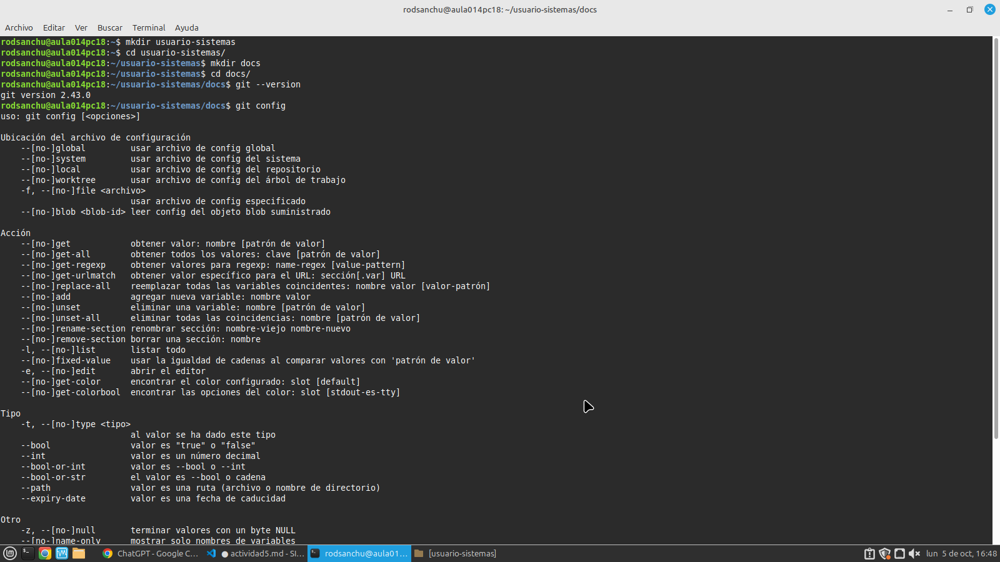
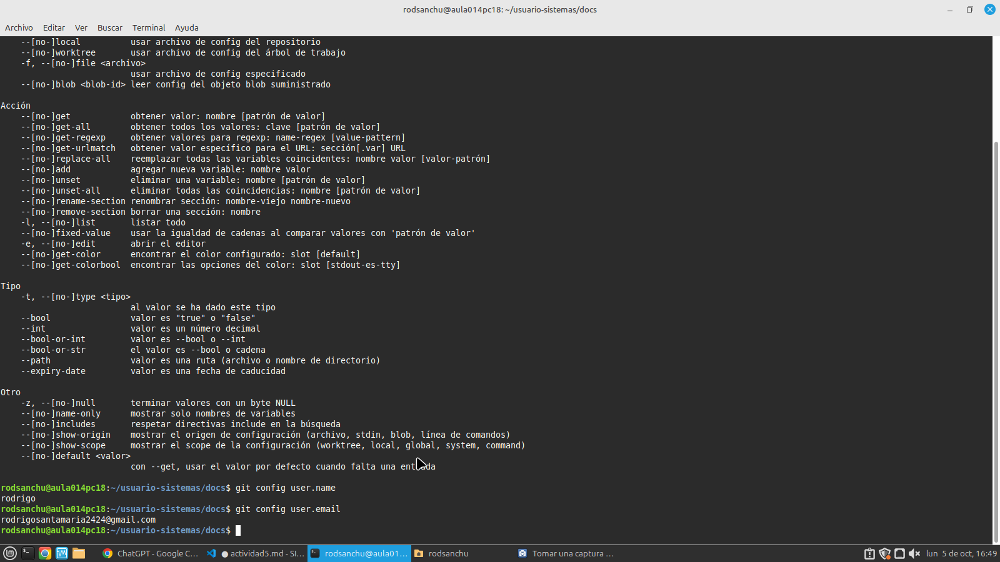

# Práctica de Git

## 1. Comprobar Git y creación del directorio.

### Comprobar que Git está instalado.

Para comprobar que Git está instalado en el sistema, ejecutamos el siguiente comando, también creamos el directorio usuario-sistemas/ y docs/.

 Y finalmente observamos la versión de git y tambien el nombre y el correo que sale en la terminal:

## 2. Repositorio
### Comprobar el directorio.
Ya creado el repositorio observamos que el directorio contiene la información utilizada por Git.

