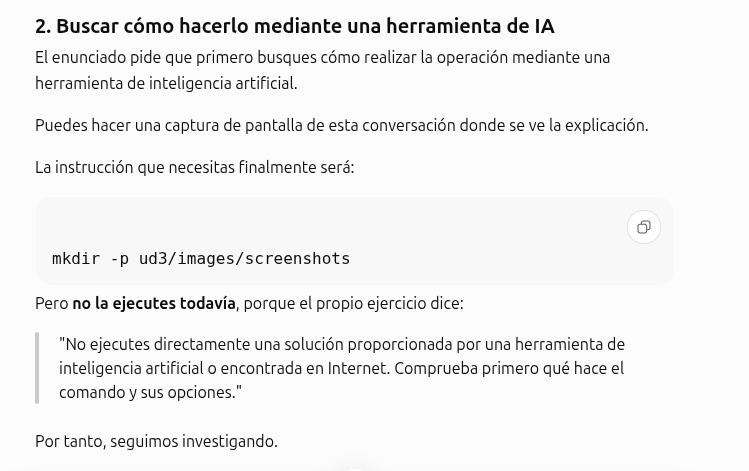
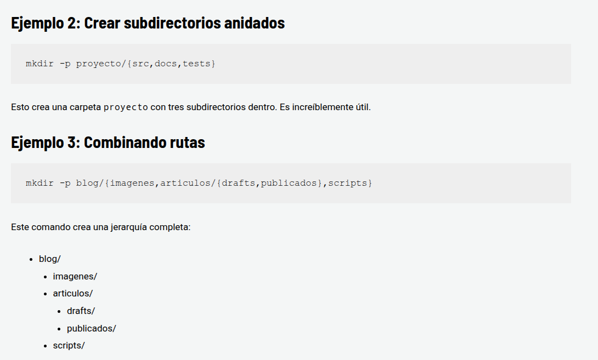
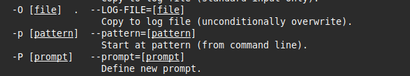
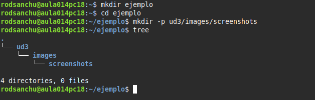

# ACTIVIDAD 2

>1. Busca cómo realizar la operación mediante una herramienta de inteligencia artificial.
>2. Realiza también la búsqueda mediante un buscador.
>3. Identifica el comando y las opciones necesarias.
>4. Contrasta la solución con documentación oficial utilizando los métodos estudiados.
>5. Ejecuta la solución y comprueba que se ha creado correctamente la estructura solicitada.

# 1
Primero he buscado en Chatgpt de OpenAI como resolver el problema, y me ha dado esta solución.

# 2 
Ahora he buscado mediante Gooogle en HostingTG como poder resolver el problema y me ha dado esta solución

# 3
Ahora voy a comprobar si es verdadero la información que me ha dado chatgpt y la que he buscado en HostinTG

Primero busco en el terminal lo que es el comando -p y contrasto la informacion que he encontrado.

# 4

Despues compruebo.

Y como podemos ver ya esta creada.
