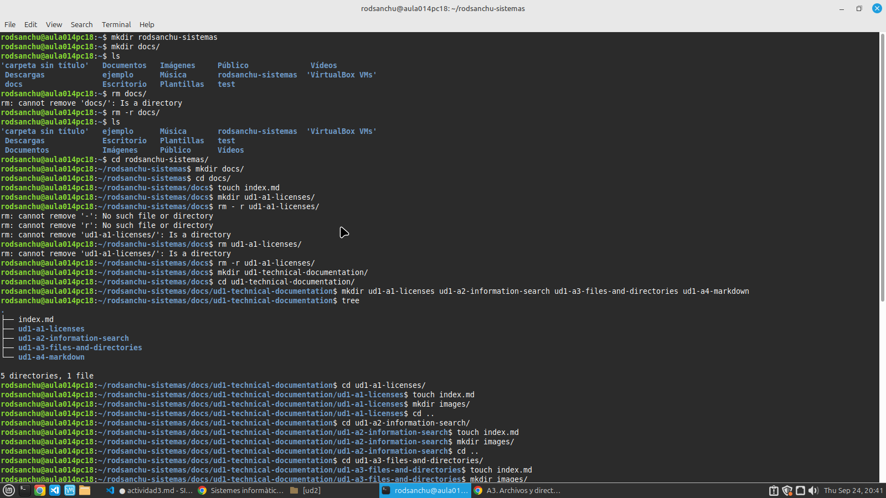
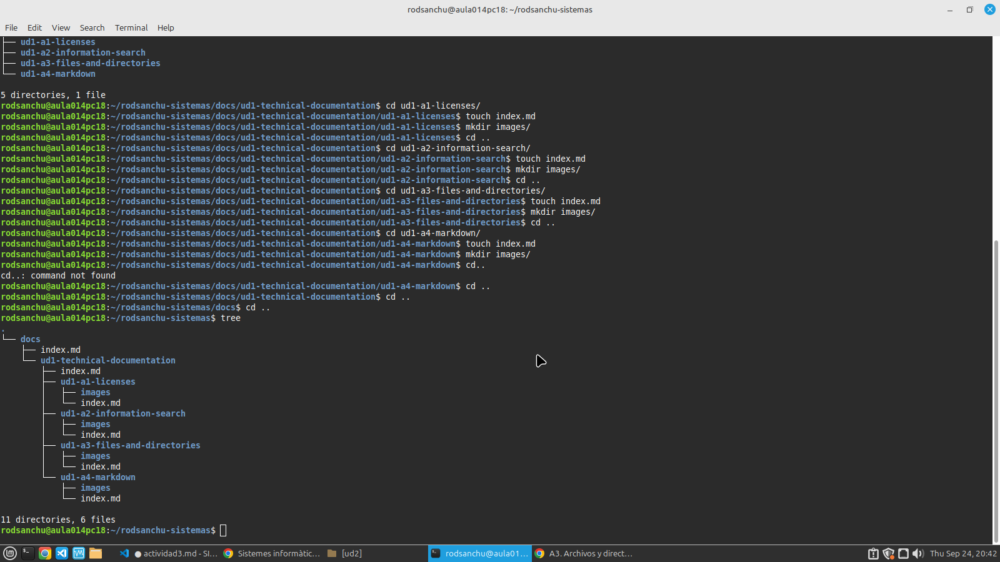

# ACTIVIDAD 3  -DIRECTORIOS Y ARCHIVOS
>Inicialmente voy a abrir la terminal para crear el directorio en el cual voy a realizar la actividad, y a empezar a usar el mkdir y el touch para poder crear todas las carpetas y sus respectivos archivos.

>Despues voy a mover todo lo realizado anteriormente con el comando move como pide la tarea.

 mkdir -p ~/rodsanchu-sistemas/docs/{ud1,ud2,ud3} && \
mv ~/docs/ud1/index.md ~/rodsanchu-sistemas/docs/ud1/ && \
mv ~/docs/ud2/index.md ~/rodsanchu-sistemas/docs/ud2/ && \
mv ~/docs/ud3/index.md ~/rodsanchu-sistemas/docs/ud3/

>Con este pequeño código ya moví todo lo que necesitaba mover lo único que al cambiar de ordenador ya lo tengo hecho.